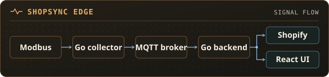
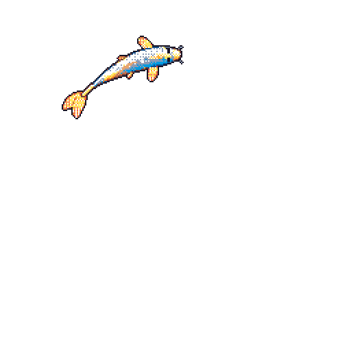

# 👋 I’m Atharva Kanawade

**I build software for factory floors and FPV drones for race day.**

🏭 I’m a **Software Engineer at Golain** in Pune, India, building tools around how shop-floor teams work and collect data.

🌐 **[Portfolio](https://www.atharvakanawade.dev/)** · 💼 [LinkedIn](https://www.linkedin.com/in/atharvakanawade/) · ✉️ [Email](mailto:atharvakanawade@gmail.com)

## 🛠️ Featured builds

⚙️ **[ShopSync Edge](https://github.com/05Atharva/shopsync-edge)** turns Modbus signals from factory equipment into Shopify updates and live dashboard events. Go at the edge, MQTT for messaging, React for the dashboard.

🏁 **[3-inch FPV racer](https://github.com/05Atharva/3inch-fpv-racing-drone)** is a compact quad I built with Team Vajra. We finished **3rd worldwide and 2nd in India** in FPV racing at [TechnoXian 2025](https://mmcoe.edu.in/departments/e-tc/student-achievements/). [Build photos](https://github.com/05Atharva/3inch-fpv-racing-drone/tree/main/media)

🔬 **[ARTEMIS](https://github.com/05Atharva/ARTEMIS)** combines ML-based phishing detection with wireless and cloud security monitoring. I co-authored the [IEEE paper](https://ieeexplore.ieee.org/document/11447964) for ICEI 2026.

## More work

🤖 At **Applied AI Consulting**, I worked on multi-agent workflows with LangGraph and production backends with FastAPI and PostgreSQL. I wrote tests for about 40 modules, bringing coverage to 75%.

🏏 **[MatchSense](https://github.com/05Atharva/MatchSense)** studies what can be predicted before an IPL match and skips predictions when its CatBoost model has low confidence.

🎧 **[RagaStream](https://github.com/05Atharva/RagaStream)** is a personal Android app for Indian music built with React Native, FastAPI, and Supabase.

## 🐟 My Git Koi

The languages I use color its markings, and my public GitHub activity changes how it swims. [How Git Koi works](https://github.com/yalongwastaken/git-koi)

<picture>
  <source media="(prefers-reduced-motion: reduce)" srcset="assets/koi/koi.png">
  
</picture>
