# Atharva Kanawade

**I write software for factory floors and build the FPV drones I race.**

I’m a **Software Engineer at Golain** in Pune, India. I design tools around how shop-floor teams work and collect data.

[**Portfolio ↗**](https://www.atharvakanawade.dev/) · [Selected work ↓](#selected-work) · [LinkedIn](https://www.linkedin.com/in/atharvakanawade/) · [Email](mailto:atharvakanawade@gmail.com)

## Selected work

- **[ShopSync Edge](https://github.com/05Atharva/shopsync-edge)** connects factory equipment signals to Shopify and a live React dashboard using Go, Modbus, and MQTT.
- **[MatchSense](https://github.com/05Atharva/MatchSense)** predicts IPL results before a match starts and sits out when the CatBoost model has too little confidence.
- **[RagaStream](https://github.com/05Atharva/RagaStream)** is a personal Android app for Indian music, built with React Native, FastAPI, and Supabase.
- **[ARTEMIS](https://github.com/05Atharva/ARTEMIS)** combines machine learning for phishing detection with wireless and cloud security monitoring. We presented it at ICEI 2026. [Read the IEEE paper](https://ieeexplore.ieee.org/document/11447964).

## Beyond the repositories

At **Applied AI Consulting**, I worked on multi-agent AI workflows with LangGraph and production backends with FastAPI and PostgreSQL. I wrote tests for about 40 modules, bringing test coverage to 75%.

At **Team Vajra**, I led AI and ML work on UAV projects and built FPV racing drones with the team. We placed **3rd worldwide and 2nd in India** in drone racing at TechnoXian 2025. [Competition results](https://mmcoe.edu.in/departments/e-tc/student-achievements/) · [3-inch FPV build](https://github.com/05Atharva/3inch-fpv-racing-drone)
